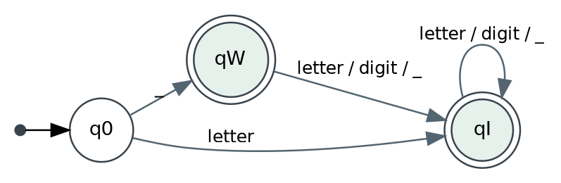
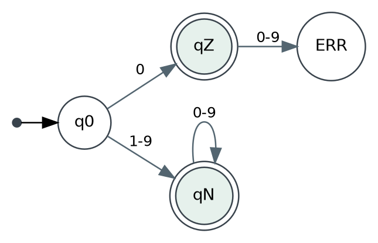
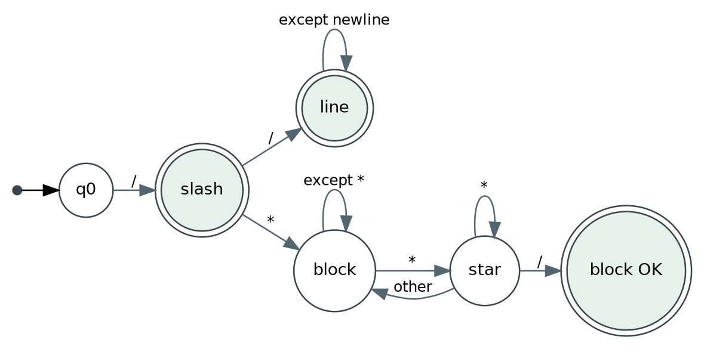
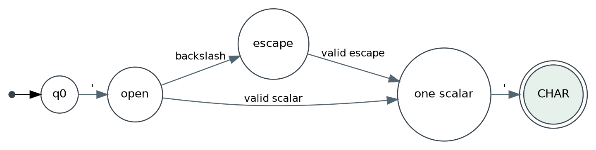
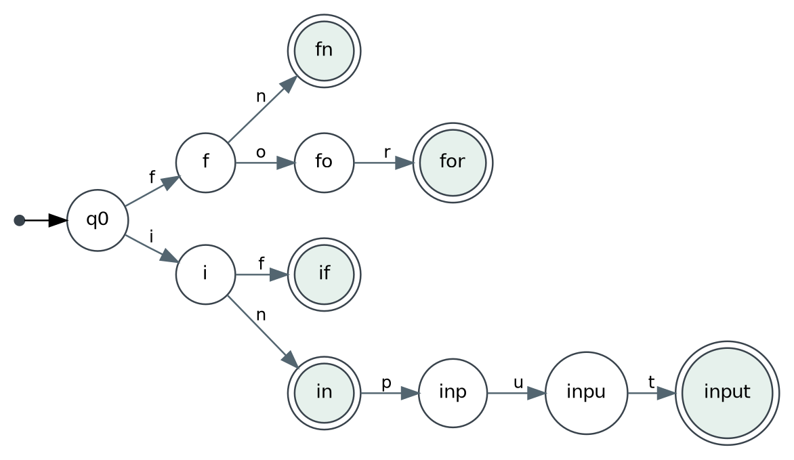

# Ternfold lexical finite automata (course target revision 2)

These are **lexical recognition automata**, distinct from the runtime's propose/validate/publish state machine. Input is UTF-8 decoded to Unicode scalars with byte spans maintained by SourceFile. Tokens follow maximal munch, followed by keyword/reserved/noise classification. An invalid lexeme yields a structured E10x diagnostic and `INVALID` row in the educational report. DFA transitions below are specification requirements; implementations may use an equivalent explicit byte-indexed scanner.

## 1. ASCII identifiers and keyword recognition

Alphabet classes: L = `[A-Za-z]`, D = `[0-9]`, U = `_`, O = any other scalar. Q0 start, Q1 identifier accepting, QW standalone wildcard accepting if input is exactly `_`, QX failure. On L: Q0 -> Q1. On U: Q0 -> QW. From QW: L/D/U -> Q1. From Q1: L/D/U -> Q1. On O: stop and accept maximal prefix. During recognition, advance the finite name-prefix DFA once per scalar. Its
terminal metadata supplies keyword TokenKind and reserved-name flag only at the
maximal identifier boundary. Missing trie edges enter the generic identifier
sink. No completed-input-word lookup, spelling-set comparison, regex tokenizer
or premade lexical analyzer is permitted. The inventory constructs transitions
once; it is not queried using the completed input. `from`/`to` are recognized by
the same DFA and their contextual NOISE_WORD view uses token-kind transitions.

Keywords: `as div else emit enum false fn for from guard if import in input let machine match next output pub record rejects state stdin stdout to true yields` (28). Include complete function table from the original proposal and amendment. The non-identifier `_` is a wildcard/discard.

## 2. Decimal Int/Float DFA and recovery (ADR 0010)

Alphabet classes: D=[0-9], N=[1-9], E=e/E. Signs are separate tokens except
within an exponent. Regex reference:
`INT = 0|[1-9][0-9]*`;
`FLOAT = (0|[1-9][0-9]*)(\.[0-9]+([eE][+-]?[0-9]+)?|[eE][+-]?[0-9]+)`.

| State | Input | Next/action |
|---|---|---|
| Q0 | 0 / N | QZ / QN (Int accepting) |
| QN | D | QN |
| QZ | D | QE leading-zero invalid |
| QZ/QN | dot with following D | QDot; consume required D into QF |
| QF | D | QF (Float accepting) |
| QZ/QN/QF | E | QExp, not yet accepting |
| QExp | + or - | QSign, not accepting |
| QExp/QSign | D | QED (Float accepting) |
| QED | D | QED |
| numeric accepting | identifier continuation or second dot followed by D | QE E102 |
| QExp/QSign | no required D | QE E102 |
| numeric accepting | other | stop before boundary |

A dot joins only before a digit, preserving `1.foo` as INT DOT IDENT and
`1.2.foo` as FLOAT DOT IDENT. In QE extend through ASCII alphanumeric/underscore
and dots only before a digit; +/- joins only an exponent-sign position. Preserve
other punctuation, whitespace and comment starts. `1e+`, `1efoo`, `1.2.3` are
single INVALID runs; `1e++2` is INVALID(1e+) PLUS INT; `1efoo.bar` is INVALID
(1efoo) DOT IDENT. Syntax E102 precedes type/range checks. Well-formed `1e999`
is FLOAT lexically and E301 in checking; `1e999foo` is lexical E102. `00`/`09`
remain one invalid run. The decimal_integer.png diagram below illustrates only
the Int subset; this explicit transition table owns the added Float paths.

Minus is never part of INT/FLOAT: signed ranges and finite correctly rounded
binary64 conversion belong to C01 typing, preserving exact lexeme/byte spans.

## 3. Comment disambiguation DFA

```
Q0 --'/'--> QSlash [ACCEPT division]
QSlash --'/'--> QLine --any except LF/CRLF--> QLine [ACCEPT comment at newline/EOF]
QSlash --'*'--> QB --any except '*'--> QB --'*'--> QStar
QStar --'/'--> QDone [ACCEPT block comment]
QStar --'*'--> QStar ; --other--> QB
QB/QStar --EOF--> QE [REJECT unterminated E104]
```

Comments do not nest (`/* one /* two */` ends at first `*/`). `div` is the only floor division spelling; `//` is **always a comment**.

## 4. Character literal recognizer

`'` opens Char -> accept one normal nonquote Unicode scalar or supported backslash escape -> require closing `'`; `''`, `'ab'`, unclosed quotes, bad escapes, surrogate/raw control are E105. Unicode escapes require 1–6 hexadecimal digits, scalar <=10FFFF, excluding surrogate range. Char literal value is exactly one scalar even if UTF-8 requires multiple bytes. String recognizer is analogous but repeats scalar/escape until closing `"`, and uses E103.

## 5. Maximal-munch operator groups

From `:` look ahead for `::`; from `-` for `->`; from `=` for `=>`/`==`; from `!` for `!=`; from `<`/`>` for `<=`/`>=`; from `&` for `&&`; from `|` for `||`; from `+` for `++`; from `/` for `//` or `/*`. `^` and `%` are single-glyph operators. A solitary `&` or `|` is invalid outside declared token forms. Scanner ensures source span points to the original bytes.

## 6. Acceptance examples / counterexamples

| Lexeme | Expected |
|---|---|
| `student_count2` | IDENT |
| `_` | UNDERSCORE |
| `machine` | KEYWORD |
| `from` in `input x: Text from stdin;` | NOISE_WORD |
| `Int` in declaration type | RESERVED_NAME report overlay |
| `29` | INT_LITERAL |
| `029` | E102 / INVALID |
| `true` | BOOL_LITERAL |
| `"hello"` | TEXT_LITERAL |
| `'Ω'` | CHAR_LITERAL |
| `/*note*/` | COMMENT_BLOCK |
| `// note` | COMMENT_LINE |
| `/* unclosed` | E104 / INVALID |
| `''` | E105 / INVALID |
| `1.5`, `1e-3` | FLOAT_LITERAL |
| `^`, `div`, `/` | Checked power, integer floor division, real division |
| `@` | E101 / INVALID |

Diagrams and matching transition tables are included in the proposal amendment. For all tests, validate both accepted token kind and exact byte span; testing only regex acceptance is insufficient.

## Diagrams (included for offline study)












## Mandatory operator-count inventory

Seven arithmetic spellings, independently recognized: `+ - / * % div ^`.
Nine logical/relational spellings, independently recognized:
`&& || ! > < == != >= <=`. Assignment, `++`, arrows and delimiters do not
contribute to these counts. `/` is real division; `div` integer division.
Recognition tests and representative all16 source/report are required; a DFA
picture alone never verifies implementation or numerical execution. Portable
code does not establish a POSIX pass without an actual POSIX run.
