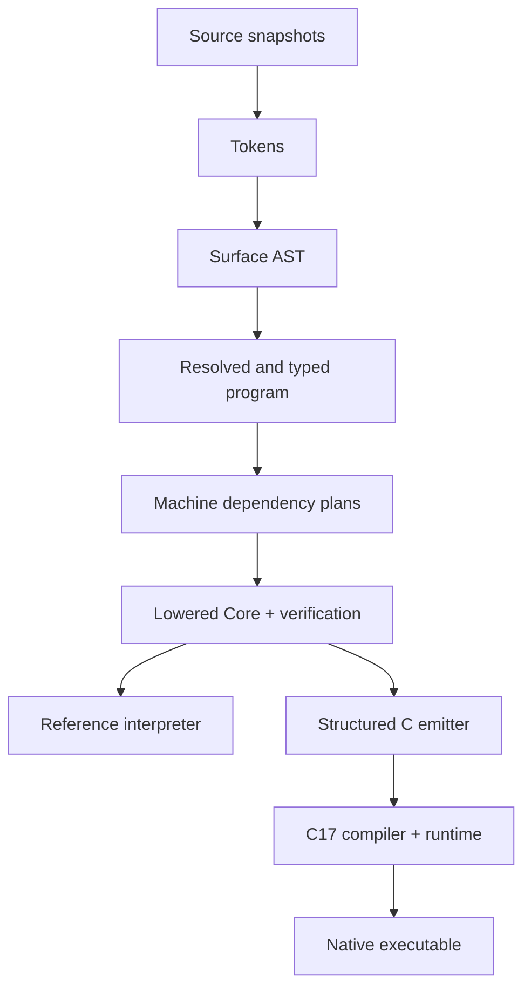

# Pipeline and introspection

The AST records syntax; TypedProgram attaches resolved IDs and checked types while preserving sugar; MachinePlan makes old/candidate read sets and order visible; Core removes machines and pattern syntax for both execution paths. There is **one** executable IR. No bytecode, LLVM IR, or second CFG layer in 0.1.

## CLI contract

Current commands are `--help`, `--version`, `status`, `tokens`, `ast`, full-frontend `check`, `plan`, and `core` (including `--symbol-table`, `--root`, `--diagnostic-format`, `--color`). The following commands become available only in their roadmap tasks. Unknown/unimplemented commands currently fail with exit 2; do not pretend source programs run.

| Command | Stops at / purpose | Introduced |
|---|---|---|
| `ternfold tokens file.tfd` | Lexer token kind/payload/span dump | M03 |
| `ternfold ast file.tfd` | Surface AST, including spans | M04 |
| `ternfold check file.tfd` | Full semantic validation, no execution | M07 (subset earlier) |
| `ternfold plan file.tfd` | Per-machine writer graph, old-read set, stable order and guard order | M07 |
| `ternfold core file.tfd` | Verified lowered Core text | M08 |
| `ternfold run file.tfd` | Interpret Core, print main's complete output | M09 |
| `ternfold emit-c file.tfd -o out.c` | Authored C source, includes runtime header | M11 |
| `ternfold build file.tfd -o app` | Native executable with runtime linked | M11 |
| `ternfold repl` | Session expression/binding evaluation | M13 |

Common future options: `--root DIR`, `--diagnostic-format text|json`, `--color auto|always|never`. `run` accepts `--max-steps N` (Core instruction dispatch budget) and `--max-depth N` (call frames); defaults 10,000,000 and 1,024 in the interpreter. Native execution uses the same depth limit in its context, but instruction fuel is a driver/debug option, not part of language equivalence. `--cc PATH` is for build only. `emit-c` emits one translation unit plus a comment naming required runtime ABI version, not a standalone amalgamation. Building generated C directly requires the documented header/runtime paths.

Successful commands exit 0; source/type errors 1; CLI/input/build-host errors 2; language runtime faults 3; internal compiler invariant failure 70 (include a reportable issue summary, traceback only with explicit developer flag). A domain Reject is ordinary data and never changes the process exit code by itself. OS output errors are exit 2. JSON diagnostics go to stderr; program text/dumps to stdout unless an output file was selected. `check` emits no success chatter by default.

## REPL semantics (M13)

REPL evaluates expressions and `let` bindings through the same frontend/typechecker/lowering/interpreter. It accepts a complete top-level declaration or a complete expression/binding unit, accumulating lines by token-aware delimiter balance (not raw brace counting inside strings). `:load path`, `:reset`, `:type expression`, `:plan MachineName`, and `:quit` are the command set. `:load` replaces the session module environment only on complete success; failure leaves it unchanged. Session bindings cannot be redefined within a session (reset or choose another name). Each successful unit adds its immutable values; a rejected machine decision is still a successful expression. Static/runtime failure commits no new bindings. Displaying the resulting value is a REPL host action; it is not an implicit language print. Display has a bounded depth/length, while `main` output does not use debug formatting. REPL does not introduce mutation or special evaluation semantics.

## Debug information

Core instruction origins include source NodeId plus an origin kind (`user`, `machine-writer`, `guard`, `emission`, `pattern-test`, `closure-lift`). Dumps use deterministic IDs per compilation and root-relative paths, never Python object addresses. `plan` includes edge spans to explain a cycle and an explicit note that guards are runtime checks. Future optional tracing records actually executed writer/guard/emission events separately from the static plan; trace order is execution order, not topological layers.

## Revision 2 CLI/course adapters (frontend available; execution pending)

`ternfold tokens file.tfd --symbol-table "Symbol Table.txt"` writes the UTF-8 deterministic rubric-facing lexical report, including an `INVALID` classification for rejected lexemes while preserving compiler diagnostics and true tokens. A `.tfd` extension is mandatory for source and import paths. The `check` command through M05 must **not** depend on M06 type analysis; run/check driver phases explicitly. `run` and native `build` launchers capture stdin before main; tests may supply deterministic inputs from `--stdin-file`. The ordinary `main: List[Text]` result remains part of host output after staged `output` clauses. Feature gating and tests are outlined in docs/course-requirements.md.

## Numeric contract and correction gate

Accepted ADR 0010 requires real `/` returning finite Float and integer `div`,
with seven arithmetic/nine logical-relational operator spellings. C01 verifies
lexical/type/constant/report amendments before M08. Int/Float literal origins,
checked operation faults and canonical text must survive Core lowering and both
executors. Current frontend success does not establish interpreter or C17 parity.
The explicit .tfd-only input policy applies to every future source command.

## Approved I/O-bearing main reference boundary

A root public `main` with any outer input/output clause is host-entry-only.
Source references to its resolved symbol are E208 (calls, function values,
recursion, closure/machine references); the generated adapter is not nameable.
A main without I/O remains callable. Apply the rule by identity, preserving
shadowed/unrelated names. Human-approved clarification is recorded in ADR 0009;
`tests/test_entry_boundary.py` supplies positive/negative regressions.
